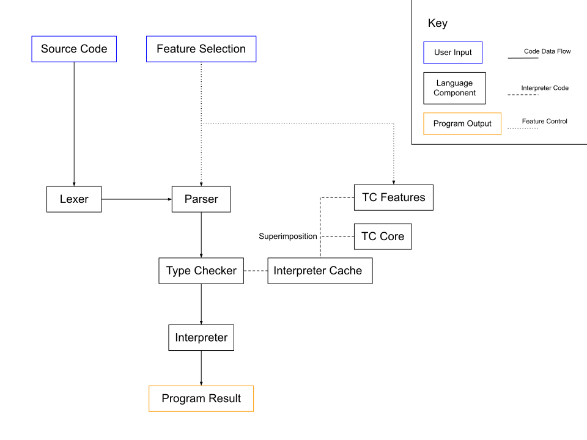

# Design

## Overview

An interpreted feature modular language written in Haskell. Lexer is generated
from Alex, and parser is generated from Happy.

[Requirements](./REQUIREMENTS.md)

## Architecture

**Switching Between Features**: When a feature selection is made, the
interpreter is recompiled with the specified feature flags, that version is
locally cached, and the new interpreter is run on the given source code.

**Input**:
- Source Code: Source code given by the user.
- Feature Selection: Selection of language features to include given by the
  user.

**Language Components**:
- Lexer: Tokenizes the source code and passes tokens to the parser as they are
  generated. The lexer is generated by Alex.
- Parser: Parses tokens to form an abstract syntax tree (AST). The parser is
  generated by Happy. IFDEF blocks will be used to separate features with the
  preprocessing done by `unifdef`. 
- Type Checker: Verifies correctness of types of functions and values in the AST.
- TC Core: The core set of features for the type checker.
- TC Features: The extended set of features to be superimposed onto the TC core.
- Interpreter Cache: Cache of interpreters of a specific feature set.
- Interpreter: Part of the interpreter as a whole to execute the AST.

**Output**:
- Program Result: The executed output of the user specified program, or an
  error.

## Interfaces

The program will be interfaced through the command line, similar to other
interpreters like Python or GHCi.

## Data

Source code is given as a string of characters either as a file or through the
command line.

Interpreter feature compilations are kept in a cache as to reduce the number
of interpreter recompilations.

## Deployment

This project will be deployed as an installable package or source code with
a simple compilation/installation process.

## Open Questions

- How will the user select features?
- What is the definition of each feature, and how will these features depend
  on each other.

## Deferred Questions

- What is the structure of interpreter error, how will it propagate, and how
  will it be displayed to the user?
  - An initial starting point for the implementation of the parser/type checker
    is needed before a decision can be made.
